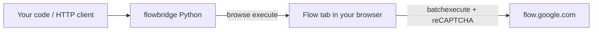

# flowbridge: an unofficial API for Google Flow

Generate **Veo / Omni videos** and **Nano Banana images** from code with the credits of your own Google AI subscription (Pro or Ultra). You don't need an API key or a Vertex/Gemini billing account.

> **Unofficial.** This tool is not affiliated with Google. It drives the [Flow](https://flow.google.com) web app through internal endpoints that can change without notice. Automating a consumer account may violate Google's Terms of Service. Use it for personal projects and at your own risk.

## How it works

Every Flow generation request needs a fresh **reCAPTCHA Enterprise** token, and only a real browser can produce one. A headless HTTP client therefore can't call Flow. `flowbridge` runs each request inside a Flow tab in **your own logged-in browser**, through [browse](https://github.com/anomalyco/browse), and passes the results back to Python. The tab opens in the background and you can keep using your browser.



## Requirements

- A Google account with Flow access (Google AI Pro or Ultra), logged in at <https://flow.google.com> in a Chromium-based browser (Chrome, Edge, Brave, Arc…). Open Flow once by hand first so the welcome and consent dialogs are dismissed.
- [browse](https://github.com/anomalyco/browse), a CLI plus browser extension:
  ```sh
  curl -fsSL https://opencode.ai/browse/install | bash   # or: npx @opencode/browse install
  browse doctor                                          # must show the extension connected
  ```
- Python 3.9 or newer. No other dependencies.

## Install

```sh
pip install git+https://github.com/keethesh/flowbridge
# or clone the repo and run: pip install -e .
```

## Python usage

```python
from flowbridge import Flow

f = Flow()           # reuses (or creates) a Flow project named "Flow API"
                     # use a specific one: Flow(project="<uuid>") or FLOW_PROJECT=<uuid>
f.credits()          # remaining credits, e.g. 1034

# Images: synchronous; Nano Banana currently costs 0 credits
imgs = f.image("a red apple on a wooden table", aspect="1:1", count=2, out_dir="out")
# -> [{"media_id": "...", "url": "https://flow-content.google/image/...", "path": "out/<id>.jpg"}]

# Videos: spend credits; blocks until the clip is ready, then downloads it
clip = f.video("a paper boat drifting on a pond at sunrise", aspect="9:16", out="boat.mp4")

# Image-to-video: start from an image (a local file is uploaded first, or pass a Flow image media_id)
f.video("the pear slowly spins", start_image="pear.jpg", out="spin.mp4")

# First/last frame: the clip starts on one image and ends on the other
f.video("the pear morphs into a cactus", start_image="pear.jpg", end_image=imgs[0]["media_id"], out="morph.mp4")

f.upload("photo.png")                  # -> media_id, if you want to reuse an image across calls

# Or asynchronously
job = f.submit_video("...")            # {"media_id", "credits_left"}; same frame arguments as video()
f.media(job["media_id"])               # {"status": "pending|success|failed|canceled", "url": ...}
```

Frames are centre-cropped to the video aspect ratio, as in the Flow UI. With no `model`, each mode defaults to Omni 1.2 Flash, 8s, 360p, 8 credits: `macaron_cookie_t2v_8s_360p`, `macaron_cookie_i2v_8s_360p` or `macaron_cookie_i2v_fl_8s_360p`. If you pass a `model`, its key must match the mode: `t2v` for text only, `i2v` for a start frame, and a first/last key (`*_i2v_fl_*`, `*_first_last*`, `veo_3_1_i2v_s_*_fl`) for start plus end.

**Pick models with `f.models()`.** It returns every model your account can use, with the credit cost per account tier:

```python
for fam in f.models()["video"]:
    print(fam["name"], [(k["key"], k["credits"]) for k in fam["keys"]][:3])
```

Video model keys encode model, mode, length and resolution, e.g. `macaron_cookie_t2v_8s_360p` (Omni 1.2 Flash, text-to-video, 8s, 360p, 8 credits), `abra_i2v_4s_360p` (Omni 1.1 Flash image-to-video, 4 credits), `omni_flash_i2v_4s_first_last_360p` (Omni 1.1 Flash first/last frame, 4 credits), `veo_3_1_t2v_lite`, `veo_3_1_i2v_s_fast_fl`, `veo_3_1_t2v` (Quality, 100 credits). Image models: `BELUGA` (Nano Banana 2.1, the default), `GEM_PIX_2` (Nano Banana Pro), `HARBOR_SEAL` (Nano Banana 2 Lite).

**Check the price before you loop.** Video credits are real money.

| | aspect ratios |
|---|---|
| image | `16:9 9:16 1:1 4:3 3:4 3:2 2:3 5:4 4:5 21:9 4:1 1:4 8:1 1:8` |
| video | `16:9 9:16` |

## HTTP server (any language)

```sh
flowbridge serve --port 8787          # or: python -m flowbridge serve
```

| Method | Path | Body / result |
|---|---|---|
| GET | `/credits` | number |
| GET | `/models` | model catalog |
| GET | `/projects` | `[{id, title}]` |
| POST | `/projects` | `{"title"}` → project id |
| POST | `/images` | `{"prompt", "model"?, "aspect"?, "count"?, "seed"?, "out_dir"?}` |
| POST | `/uploads` | `{"path"}` (a file on the server machine) → media_id |
| POST | `/videos` | `{"prompt", "model"?, "aspect"?, "start_image"?, "end_image"?, "wait"?, "out"?}`; frames are a server-side path or a media_id. Without `"wait": true` it returns `{media_id, credits_left}` right away |
| GET | `/media/<id>` | status plus a downloadable mp4 `url` |

```sh
curl -s localhost:8787/images -d '{"prompt":"a lighthouse at night","aspect":"9:16"}'
curl -s localhost:8787/videos -d '{"prompt":"a hummingbird","wait":true,"out":"bird.mp4"}'
```

The server binds to `127.0.0.1`, and it should stay there: anyone who can reach it can spend your credits. Requests run one at a time because there is a single browser tab.

## Notes and limits

- **Links expire.** Image URLs are signed and work without cookies for a few hours. Video `url`s are signed `googlevideo.com` links tied to your IP for about 2 hours, and they need a browser-like `User-Agent` (`flowbridge` sends one).
- **Not implemented:** ingredients (reference images), extend and upscale. Their model keys appear in `models()`, but those payloads were never captured.
- **One browse session.** `flowbridge` uses a browse session named `flowbridge`. Idle agent tabs close after about 10 minutes, and the next call reopens one.
- **Logged out?** Calls fail with "Flow not ready (logged out?)". Log in at flow.google.com in the browser that browse is connected to.

## Protocol notes

These notes were reverse engineered from frontend build `boq_labs-ai-sandbox-frontend_20261108.05_p0`, and they are what you need when Google changes the site.

Transport: `POST https://flow.google.com/_/AiSandboxAngularFrontend/data/batchexecute?rpcids=<id>&bl=<cfb2h>&f.sid=<FdrFJe>&rt=c` with form body `f.req=[[[id, JSON(payload), null, "generic"]]]&at=<WIZ_global_data.SNlM0e>`. Auth is cookies only. Request context: `[null, 22, null,null,null, projectId, null,null,null,null, [recaptchaToken, 1]]`, where the reCAPTCHA Enterprise site key is `6LdsFiUsAAAAAIjVDZcuLhaHiDn5nnHVXVRQGeMV`.

| RPC | Purpose | Payload → result |
|---|---|---|
| `nzlxg` | credits | `[]` → `[credits, …]` |
| `HTrJv` | model catalog | `[]` → `[0][4]` video, `[0][5]` image: `[name, [[key, …, creditsPerTier@4, …]], _, family]` |
| `UpteDb` | list projects | `["projects/*", 21, null,null,null,null, [1]]` → `[[id, [title, …]], …]` |
| `jHPbke` | create project | `["projects/*", [null,[title]], [null,22]]` → `[projectId, [title]]` |
| `ogiZ0b` | image (sync) | `[null, [item…], 1, ctx, [uuid]]`, with item `[null,null,null, seed, aspect, model, null, ctx, [[[prompt]]], null,null,null, uuid, uuid, 4]` → `[0][i][0]` mediaId plus a signed `flow-content.google/image/…` URL. reCAPTCHA action `IMAGE_GENERATION` |
| `YhhmEf` | text-to-video (async) | `[[[[null,null,[[[prompt]]]], modelKey, aspect, null, [null×4, uuid, uuid], null,null,[4]]], ctx, [uuid, 2]]` → `[1]` credits left, `[3][0][0]` mediaId. reCAPTCHA action `VIDEO_GENERATION` |
| `eb1hJf` | image-to-video | same as `YhhmEf`, with item `[text, modelKey, aspect, null, frame, [null×4, uuid, uuid], null,null,null,[4]]` |
| `nprQif` | first/last frame video | same, with item `[text, modelKey, aspect, null, startFrame, endFrame, [null×4, uuid, uuid]]` |
| `maseQ` | upload image | `[ctx, base64, mime, 1, null×4, filename, null, uuid, uuid]` → `[0][0]` mediaId. reCAPTCHA action `UPLOAD_IMAGE` |
| `as29s` | get media | video: `[mediaId, null, [1]]` → status `[5][8][0]` (2 pending, 3 success, 4/7 failed, 5 canceled), asb token URL at `[5][10]`. Image: `[mediaId]` → includes a signed `flow-content.google/image/…` URL |
| `jwpduf` | batch status poll (used by the UI) | `[null, null, [[mediaId]]]` |

Aspect enums: image `16:9=3, 9:16=2, 1:1=1, 4:3=5, 3:4=4, 3:2=7, 2:3=6, 5:4=9, 4:5=8, 21:9=10, 4:1=12, 1:4=11, 8:1=14, 1:8=13`; video `16:9=2, 9:16=1`.

Frame reference: `[null, imageMediaId, null, null, null, [top, left, bottom, right]]`. The crop is the centre crop to the video aspect, in fractions, with `null` for 0. For example, a 1200×896 image at 16:9 gives `[0.1233, null, 0.8767, 1]`.

Video bytes: `https://flow.google.com/asb/<token>=mm,22,15` needs cookies and 302s to an IP-bound, signed `googlevideo.com/videoplayback` URL. A CORS rule stops the page from reading that redirect. The driver therefore loads the asb URL in a hidden `<video>` and captures the redirect target from the network.

**When it breaks:** hook `window.fetch` in the page's main world (Flow calls `fetch(Request)`, so read `req.clone().text()`), do one generation by hand in the UI, and compare the payloads with the table above. The whole client lives in `flowbridge/flow_page.js`.

## License

MIT
