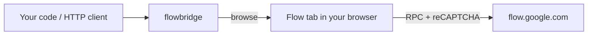

<div align="center">

# 🌉 flowbridge

**Use your Google AI subscription as an API.**<br>
Generate Veo / Omni videos and Nano Banana images in [Google Flow](https://flow.google.com) from code, without an API key or a Vertex billing account.

`Python 3.9+` · `zero dependencies` · `local HTTP API for any language` · `MIT`

</div>

> [!WARNING]
> **Unofficial and not affiliated with Google.** flowbridge drives the Flow web app through internal endpoints that can change without notice. Automating a consumer account may break Google's Terms of Service. Use it for personal projects, at your own risk.

## ✨ What it can do

| | Feature | Cost* |
|---|---|---|
| 🎬 | **Text → video** with Omni, Veo 3.1 Lite / Fast / Quality | from 4 credits |
| 🖼️ | **Image → video** from a start frame | from 4 credits |
| 🔀 | **First / last frame**: a clip that starts on one image and ends on another | from 4 credits |
| 🍌 | **Images** with Nano Banana 2.1 / Pro / 2 Lite, 14 aspect ratios | free |
| 📤 | **Uploads**: use your own images as frames | free |
| 💳 | **Credits, model catalog and prices**, read live from your account | free |

<sub>*Credits come from your Google AI Pro / Ultra plan. Prices are live; check `f.models()`.</sub>

## 🚀 Quick start

**1. Install [browse](https://github.com/anomalyco/browse).** It lets flowbridge drive your browser.

```sh
curl -fsSL https://opencode.ai/browse/install | bash   # or: npx @opencode/browse install
browse doctor                                          # should say the extension is connected
```

**2. Log in.** Open <https://flow.google.com> in that browser (Chrome, Edge, Brave, Arc…), sign in, and dismiss any welcome popups.

**3. Install and generate.**

```sh
pip install git+https://github.com/keethesh/flowbridge
```

```python
from flowbridge import Flow

f = Flow()
f.image("a red apple on a wooden table", out_dir="out")                 # free
f.video("a paper boat drifting at sunrise", out="boat.mp4")             # 8 credits
```

That's it. A Flow tab works in the background while you keep using your browser.

## 🤖 Using it with an AI agent

Paste this line into your coding agent (Claude Code, Codex, Cursor, OpenCode…):

```text
Set up flowbridge (https://github.com/keethesh/flowbridge) by following the "Agent setup" section of its README, then use it to generate what I ask for with my Google Flow subscription.
```

<details>
<summary><b>Agent setup</b> (instructions for the agent)</summary>

1. Check for `browse`: `browse doctor`. If it's missing, install it: `curl -fsSL https://opencode.ai/browse/install | bash`, then `browse install`. Pairing the extension needs the user: ask them to add the extension and approve it, then re-run `browse doctor` until the extension shows as connected.
2. Install: `pip install git+https://github.com/keethesh/flowbridge` (or clone and run `pip install -e .`).
3. Smoke test, which is free: `python3 -c "from flowbridge import Flow; f=Flow(); print(f.credits())"`.
   - "Flow not ready (logged out?)": ask the user to sign in at https://flow.google.com in the browser that browse controls, then retry.
4. Generate with the Python API below, or run `flowbridge serve` and call the HTTP API.
5. **Credits are real money.** Images are free. Before generating videos, read `f.models()` to get the price, use the cheapest model that meets the request (the default is 8 credits), and ask the user before anything over about 50 credits, Veo Quality, or loops and batches.
6. Video `url`s expire after about 2 hours and only work from the same IP. Pass `out=` to save the file instead.

</details>

## 🐍 Python API

```python
from flowbridge import Flow
f = Flow()                    # reuses or creates a Flow project named "Flow API"
                              # pick one: Flow(project="<uuid>") or env FLOW_PROJECT=<uuid>
```

| Method | Returns |
|---|---|
| `f.image(prompt, model="BELUGA", aspect="16:9", count=1, seed=None, out_dir=None)` | `[{media_id, url, path?}]` |
| `f.video(prompt, model=None, aspect="16:9", start_image=None, end_image=None, out=None)` | `{media_id, status, url, path?}`; waits until done |
| `f.submit_video(...)` | `{media_id, credits_left}` right away (same arguments, minus `out`) |
| `f.media(media_id)` | `{status, url}`; status is `pending`, `success`, `failed` or `canceled` |
| `f.upload(path)` | `media_id` of the uploaded image |
| `f.credits()` · `f.models()` · `f.projects()` · `f.create_project(title)` | account info |

`start_image` and `end_image` take a **local file path** (uploaded for you) or the **media_id** of a Flow image:

```python
f.video("the pear slowly spins", start_image="pear.jpg", out="spin.mp4")              # image → video
f.video("the pear becomes a cactus", start_image="pear.jpg", end_image="cactus.jpg")  # first / last frame
```

Frames are centre-cropped to the video's aspect ratio, as in the Flow UI.

## 🌐 HTTP API (any language)

```sh
flowbridge serve --port 8787        # or: python -m flowbridge serve
```

| Method | Path | Body → result |
|---|---|---|
| `GET` | `/credits` | → number |
| `GET` | `/models` | → model catalog with prices |
| `GET` | `/projects` | → `[{id, title}]` |
| `POST` | `/projects` | `{title}` → project id |
| `POST` | `/images` | `{prompt, model?, aspect?, count?, seed?, out_dir?}` |
| `POST` | `/uploads` | `{path}` → media_id |
| `POST` | `/videos` | `{prompt, model?, aspect?, start_image?, end_image?, wait?, out?}` |
| `GET` | `/media/<id>` | → `{status, url}` |

```sh
curl -s localhost:8787/images -d '{"prompt":"a lighthouse at night","aspect":"9:16"}'
curl -s localhost:8787/videos -d '{"prompt":"a hummingbird","wait":true,"out":"bird.mp4"}'
```

Without `"wait": true`, `/videos` returns right away; poll `/media/<id>` until it's done. Keep the server on `127.0.0.1`: anyone who can reach it can spend your credits.

## 🎛️ Models and aspect ratios

`f.models()` lists every model on your account and its price. Video keys encode **model, mode, length and resolution**:

| Key | Model | Mode | Credits |
|---|---|---|---|
| `macaron_cookie_t2v_8s_360p` | Omni 1.2 Flash | text → video *(default)* | 8 |
| `macaron_cookie_i2v_8s_360p` | Omni 1.2 Flash | image → video *(default)* | 8 |
| `macaron_cookie_i2v_fl_8s_360p` | Omni 1.2 Flash | first / last *(default)* | 8 |
| `abra_t2v_4s_360p` · `abra_i2v_4s_360p` | Omni 1.1 Flash | text / image → video | 4 |
| `omni_flash_i2v_4s_first_last_360p` | Omni 1.1 Flash | first / last | 4 |
| `veo_3_1_t2v_lite` · `veo_3_1_t2v_fast` · `veo_3_1_t2v` | Veo 3.1 Lite / Fast / Quality | text → video | 5 – 100 |

If you choose a `model`, its mode must match your inputs: `t2v` for text only, `i2v` for a start frame, and a first/last key (`_i2v_fl_`, `_first_last`, `veo_3_1_i2v_s_*_fl`) for start + end.

**Images:** `BELUGA` (Nano Banana 2.1, the default), `GEM_PIX_2` (Pro), `HARBOR_SEAL` (2 Lite).

| | Aspect ratios |
|---|---|
| Images | `16:9` `9:16` `1:1` `4:3` `3:4` `3:2` `2:3` `5:4` `4:5` `21:9` `4:1` `1:4` `8:1` `1:8` |
| Videos | `16:9` `9:16` |

## 🧠 How it works

Every Flow generation needs a fresh **reCAPTCHA Enterprise** token, and only a real browser can produce one, so a plain HTTP client can't call Flow. flowbridge runs each request inside a Flow tab in **your own logged-in browser** and passes the results back.



## 📝 Notes and limits

- **Links expire.** Image URLs work for a few hours. Video URLs last about 2 hours, only from your IP, and need a browser User-Agent. Use `out=` / `out_dir=` to keep the files.
- **One request at a time.** There's a single browser tab, in a browse session named `flowbridge`. Idle tabs close after about 10 minutes, and the next call reopens one.
- **Not implemented yet:** ingredients (reference images), extend and upscale.
- **Logged out?** Calls fail with *"Flow not ready (logged out?)"*. Sign in at flow.google.com in the browser that browse controls.

<details>
<summary><b>🔬 Protocol notes</b> (for contributors, or for fixing things when Google changes the site)</summary>

<br>

Reverse engineered from frontend build `boq_labs-ai-sandbox-frontend_20261108.05_p0`. The whole client lives in [`flowbridge/flow_page.js`](flowbridge/flow_page.js).

**Transport:** `POST https://flow.google.com/_/AiSandboxAngularFrontend/data/batchexecute?rpcids=<id>&bl=<cfb2h>&f.sid=<FdrFJe>&rt=c` with form body `f.req=[[[id, JSON(payload), null, "generic"]]]&at=<WIZ_global_data.SNlM0e>`. Auth is cookies only.

**Request context:** `[null, 22, null,null,null, projectId, null,null,null,null, [recaptchaToken, 1]]`. reCAPTCHA Enterprise site key: `6LdsFiUsAAAAAIjVDZcuLhaHiDn5nnHVXVRQGeMV`.

| RPC | Purpose | Payload → result |
|---|---|---|
| `nzlxg` | credits | `[]` → `[credits, …]` |
| `HTrJv` | model catalog | `[]` → `[0][4]` video, `[0][5]` image: `[name, [[key, …, creditsPerTier@4, …]], _, family]` |
| `UpteDb` | list projects | `["projects/*", 21, null,null,null,null, [1]]` → `[[id, [title, …]], …]` |
| `jHPbke` | create project | `["projects/*", [null,[title]], [null,22]]` → `[projectId, [title]]` |
| `ogiZ0b` | image (sync) | `[null, [item…], 1, ctx, [uuid]]`, item `[null,null,null, seed, aspect, model, null, ctx, [[[prompt]]], null,null,null, uuid, uuid, 4]` → `[0][i][0]` mediaId plus a signed `flow-content.google/image/…` URL. Action `IMAGE_GENERATION` |
| `YhhmEf` | text → video | `[[item], ctx, [uuid, 2]]`, item `[[null,null,[[[prompt]]]], modelKey, aspect, null, [null×4, uuid, uuid], null,null,[4]]` → `[1]` credits left, `[3][0][0]` mediaId. Action `VIDEO_GENERATION` |
| `eb1hJf` | image → video | as above, item `[text, modelKey, aspect, null, frame, [null×4, uuid, uuid], null,null,null,[4]]` |
| `nprQif` | first / last | as above, item `[text, modelKey, aspect, null, startFrame, endFrame, [null×4, uuid, uuid]]` |
| `maseQ` | upload image | `[ctx, base64, mime, 1, null×4, filename, null, uuid, uuid]` → `[0][0]` mediaId. Action `UPLOAD_IMAGE` |
| `as29s` | get media | video `[id, null, [1]]` → status `[5][8][0]` (2 pending, 3 success, 4/7 failed, 5 canceled), asb URL `[5][10]`. Image `[id]` → signed image URL |
| `jwpduf` | batch poll (used by the UI) | `[null, null, [[mediaId]]]` |

**Aspect enums:** image `16:9=3 9:16=2 1:1=1 4:3=5 3:4=4 3:2=7 2:3=6 5:4=9 4:5=8 21:9=10 4:1=12 1:4=11 8:1=14 1:8=13`; video `16:9=2 9:16=1`.

**Frame reference:** `[null, imageMediaId, null, null, null, [top, left, bottom, right]]`. The crop is the centre crop to the video aspect, in fractions, with `null` for 0. For example, 1200×896 at 16:9 gives `[0.1233, null, 0.8767, 1]`.

**Video bytes:** `https://flow.google.com/asb/<token>=mm,22,15` needs cookies and 302s to an IP-bound, signed `googlevideo.com/videoplayback` URL. A CORS rule stops the page from reading that redirect, so the driver loads it in a hidden `<video>` and captures the target from the network.

**When it breaks:** hook `window.fetch` in the page's main world (Flow calls `fetch(Request)`, so read `req.clone().text()`), do one generation by hand in the UI, and compare the payloads with this table.

</details>

## 📄 License

[MIT](LICENSE)
